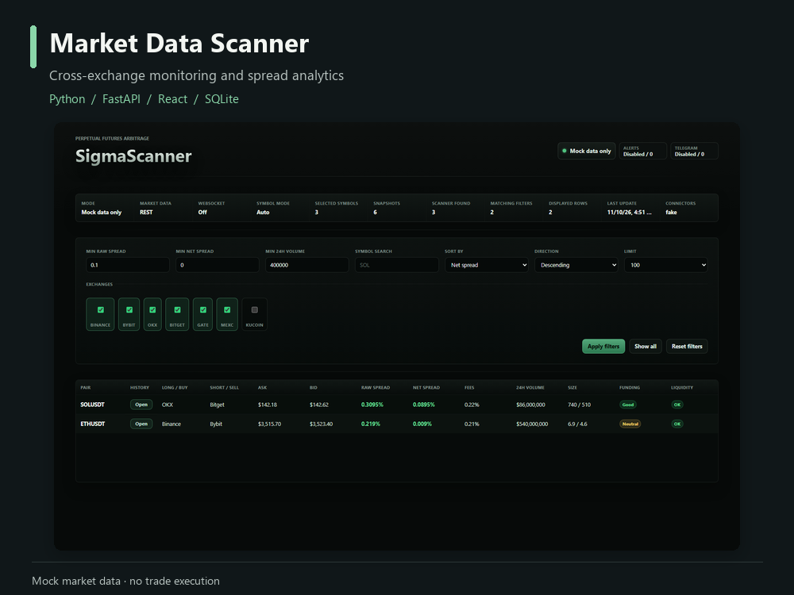

# Crypto Market Data Scanner

A read-only dashboard for comparing USDT perpetual-futures market data across exchanges.



**Python · FastAPI · React · SQLite**

[Watch the 38-second walkthrough](docs/media/demo.mp4) · [Symbol filters](docs/media/03-crypto-filtered.png) · [History analytics](docs/media/04-crypto-history.png)

## What it does

- Compares executable-side bid/ask snapshots rather than last-traded prices.
- Calculates raw spreads and estimated net spreads after configured fees.
- Filters by symbol, exchange, volume and spread thresholds.
- Stores spread samples in SQLite when history is enabled.
- Provides history charts, statistics and time-range controls.
- Includes a connector registry and optional Telegram notification components.

The application monitors data; it does not place orders or execute trades.

## Start with the built-in demo

Use Python 3.11+ and Node.js 22+. The example configuration defaults to mock data and disables external notifications.

From `backend`:

```sh
python -m venv .venv
# Activate .venv using your shell, then:
python -m pip install -r requirements.txt
python -m uvicorn app.main:app --host 127.0.0.1 --port 8000
```

From `frontend`, in a second terminal:

```sh
npm ci
npm run dev -- --host 127.0.0.1
```

Open `http://127.0.0.1:5173`. The frontend proxies API requests to the local backend.

## Configuration

Copy `config/config.example.yaml` to `config/config.yaml` for local changes. The local file is ignored by Git. To retain mock history for charts, set `history.enabled` to `true` in that local configuration. Database files remain local and are not part of the repository.

Public market-data connectors are available for Binance, Bybit, OKX, Bitget, Gate and MEXC; live operation is opt-in. Fees, market availability and data quality depend on the selected source. Keep real credentials in local environment variables, never in tracked configuration.

## Checks

From `backend`:

```sh
python -m unittest discover -s tests -v
```

From `frontend`:

```sh
npm ci
npm run build
```

## Project map

| Path | Purpose |
| --- | --- |
| `backend/app/connectors` | Independent public-data and mock connectors |
| `backend/app/services` | Scanning, normalization, calculations, filters and alert selection |
| `backend/app/db` | SQLite spread-history storage |
| `backend/app/api` | Frontend-facing API routes |
| `frontend/src` | Dashboard, filters and history views |
| `backend/tests` | Unit and mocked integration coverage |

## Portfolio demonstration

The recording runs the actual UI and backend with the built-in mock connector and a separate local history database. Displayed prices are sample data, not current quotes or achieved profit. Notifications are disabled in the demonstration.
